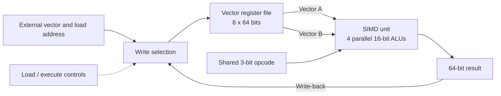

<div align="center">

# SIMD Vector Processing Unit

**4-Lane · 16-Bit · Verilog HDL**

Modern Computer Architecture | Newton School of Technology, Rishihood University


</div>

## Overview

A four-lane SIMD (Single Instruction, Multiple Data) processing unit that performs the same arithmetic or logical operation on four independent 16-bit elements in parallel. The prototype integrates four ALUs, a vector register file and clock-controlled write-back logic.

- **Vector width:** 64 bits (4 × 16 bits)
- **Register file:** 8 × 64-bit registers, two asynchronous read ports and one synchronous write port
- **Operations:** ADD, SUB, AND, OR and unsigned less-than comparison
- **Tools:** Verilog, Icarus Verilog, VVP, Surfer and VS Code

## Architecture



For example, `[10, 20, 30, 40] + [1, 2, 3, 4]` produces `[11, 22, 33, 44]` in parallel. The result is stored at an enabled rising clock edge. External loading takes priority over execution when both enables are active.

| Opcode | Operation |
| :---: | :--- |
| `000` | Addition |
| `001` | Subtraction |
| `010` | Bitwise AND |
| `011` | Bitwise OR |
| `100` | Unsigned comparison (A < B) |

## Repository Structure

```text
mca-project/
├── rtl/                  # Hardware modules
│   ├── alu16.v
│   ├── simd4.v
│   ├── vector_regfile.v
│   └── simd_core.v
├── tb/                   # Self-checking testbenches
├── docs/images/          # Simulation evidence
├── run_tests.sh          # Regression script
└── README.md
```

## Getting Started

Install Icarus Verilog on macOS, clone the repository and run all tests:

```bash
brew install icarus-verilog
git clone https://github.com/KapilKaranMathur/mca-project.git
cd mca-project
bash run_tests.sh
```

Inspect the integrated waveform with Surfer (if installed):

```bash
surfer simd_core.vcd
```

## Verification Results

| Testbench | Passing checks |
| :--- | ---: |
| 16-bit ALU | 9/9 |
| Four-lane SIMD | 5/5 |
| Vector register file | 5/5 |
| Integrated SIMD core | 13/13 |
| **Total** | **32/32** |


*Actual Surfer waveform: V0 and V1 are loaded at 15 ns and 25 ns, and the ADD result is written to V2 at 35 ns. All 32 directed functional checks passed in the recorded simulation; exhaustive coverage and hardware timing are not yet established.*

## Team Members

| Name | Enrollment No. | Institutional email | Assigned responsibility |
| :--- | :--- | :--- | :--- |
| Agrim Kumar Malhotra | 2401010045 | agrim.malhotra2024@nst.rishihood.edu.in | Core integration and control logic |
| Aniket Pathak | 2401020088 | aniket.pathak2024@nst.rishihood.edu.in | Four-lane SIMD datapath |
| Kapil Karan Mathur | 2401010209 | kapil.mathur2024@nst.rishihood.edu.in | ALU and component testing |
| Rohan Singh | 2401010391 | rohan.singh2024@nst.rishihood.edu.in | Vector register file and testing |
| Pushpendra Singh Parihar | 2401010361 | pushpendra.parihar2024@nst.rishihood.edu.in | Integrated verification and documentation |

Responsibilities reflect the team's contribution plan. See the [commit history](https://github.com/KapilKaranMathur/mca-project/commits/) for recorded contributions.

## Current Status & Next Steps

The RTL prototype and basic functional verification are complete for the current milestone. Next steps are expanded verification and instruction control, scalar-versus-SIMD cycle and throughput benchmarking, and synthesis with resource utilization and maximum-frequency analysis. No measured speed-up or FPGA timing results are claimed yet.
