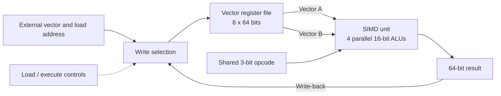
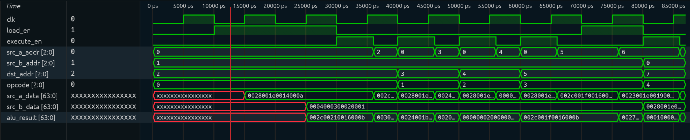

<div align="center">

# SIMD Vector Processing Unit

**4-Lane · 16-Bit · Verilog HDL**

Modern Computer Architecture | Newton School of Technology, Rishihood University


</div>

## Overview

A four-lane SIMD (Single Instruction, Multiple Data) processing unit that performs the same arithmetic or logical operation on four independent 16-bit elements in parallel. This Phase 1 prototype integrates four ALUs, a vector register file and clock-controlled write-back logic, with self-checking simulations for each component and the integrated core.

- **Vector width:** 64 bits (4 × 16 bits)
- **Register file:** 8 × 64-bit registers, two asynchronous read ports and one synchronous write port
- **Operations:** ADD, SUB, AND, OR and unsigned less-than comparison
- **Simulation:** Icarus Verilog and VVP; optional waveform inspection with Surfer

The core accepts register addresses, an opcode and load/execute enables directly. Instruction fetching, decoding and program execution are planned extensions.

## Architecture



[Phase 1 block diagram](doc/images/Block_diagram_for_phase_1.jpeg) · [Circuit diagram](doc/images/Circuit_diagram_for_phase_1.jpeg)

The register file supplies two vectors through asynchronous read ports. The SIMD unit calculates all four lane results combinationally, and the selected vector is written to the register file on the rising clock edge.

Lane 0 occupies bits `[15:0]`, lane 1 `[31:16]`, lane 2 `[47:32]` and lane 3 `[63:48]`. Vectors written as lists below use lane order `[lane 0, lane 1, lane 2, lane 3]`; Verilog concatenations place lane 3 first:

```verilog
// Lane order: [10, 20, 30, 40]
{16'd40, 16'd30, 16'd20, 16'd10}
```

For example, `[10, 20, 30, 40] + [1, 2, 3, 4]` produces `[11, 22, 33, 44]` in parallel.

| Opcode | Operation | Per-lane result |
| :---: | :--- | :--- |
| `000` | ADD | `A + B`, truncated to 16 bits |
| `001` | SUB | `A - B`, truncated to 16 bits |
| `010` | AND | Bitwise `A & B` |
| `011` | OR | Bitwise `A \| B` |
| `100` | CMP | Unsigned `A < B`: `16'd1` if true, `16'd0` otherwise |
| `101`–`111` | Unused | `16'd0` |

Arithmetic wraps modulo 65,536 within each lane; carries do not propagate between lanes.

### Load and Execute Controls

| `load_en` | `execute_en` | Action on the rising clock edge |
| :---: | :---: | :--- |
| `0` | `0` | Preserve all register contents |
| `1` | `0` | Write `load_data` to `load_addr` |
| `0` | `1` | Write `alu_result` to `dst_addr` |
| `1` | `1` | Write `load_data` to `load_addr`; external loading has priority |

Select operands with `src_a_addr` and `src_b_addr`; `src_a_data`, `src_b_data` and `alu_result` expose the current combinational values even when execution is disabled. An asserted enable causes a write on every rising edge, so deassert it after the intended write.

There is no reset or register initialization logic. Load each source register before using it; unwritten registers appear as unknown values in simulation.

## Repository Structure

```text
mca-project/
├── rtl/                  # Hardware modules
│   ├── alu16.v
│   ├── simd4.v
│   ├── vector_regfile.v
│   └── simd_core.v
├── tb/                   # Self-checking testbenches
│   ├── tb_alu16.v
│   ├── tb_simd4.v
│   ├── tb_vector_regfile.v
│   └── tb_simd_core.v
├── doc/
│   ├── images/           # Block diagram, circuit diagram and waveform
│   ├── Presentation/     # Phase 1 presentation PDF
│   └── Report/           # Phase 1 report PDF
├── video/                # Phase 1 demonstration video
├── run_tests.sh          # Regression script
└── README.md
```

## Getting Started

Install Icarus Verilog, which supplies both `iverilog` and `vvp`. On macOS with Homebrew:

```bash
brew install icarus-verilog
```

On Ubuntu/Debian:

```bash
sudo apt update
sudo apt install iverilog
```

Clone the repository and run all four test suites from its root:

```bash
git clone https://github.com/KapilKaranMathur/mca-project.git
cd mca-project
bash run_tests.sh
```

If you already have a checkout, run `bash run_tests.sh` in that directory. The script compiles with `iverilog -g2012 -Wall`, runs each testbench with `vvp` and stops on compilation or simulation failure.

The tests generate `alu16.vcd`, `simd4.vcd`, `vector_regfile.vcd` and `simd_core.vcd`, along with compiled `.out` files, in the repository root. These generated files are ignored by Git.

Inspect the integrated waveform with Surfer, if installed:

```bash
surfer simd_core.vcd
```

## Verification Results

| Testbench | Checks exercised | Passing checks |
| :--- | :--- | ---: |
| [16-bit ALU](tb/tb_alu16.v) | Five operations, comparison outcomes, overflow and underflow | 9/9 |
| [Four-lane SIMD](tb/tb_simd4.v) | All five operations across four lanes | 5/5 |
| [Vector register file](tb/tb_vector_regfile.v) | Writes, retention, asynchronous reads and disabled writes | 5/5 |
| [Integrated SIMD core](tb/tb_simd_core.v) | Vector loading, all five operations and result write-back | 13/13 |
| **Total** | | **32/32** |

All 32 directed functional checks passed with `bash run_tests.sh`. These are individual checks; some integrated scenarios verify both calculation and write-back separately.



*Surfer waveform of the integrated core: V0 and V1 are loaded at 15 ns and 25 ns, and the ADD result is written to V2 at 35 ns. The testbench uses a 10 ns clock period; this is a simulation setting, not a measured hardware frequency.*

## Phase 1 Documentation and Demo

- [Project report (PDF)](doc/Report/MCA_phase1_report.pdf)
- [Presentation (PDF)](doc/Presentation/MCA_phase1_presentation.pdf)
- [Demonstration video (MP4)](video/MCA_phase1_video.mp4)

## Team Members

| Name | Enrollment No. | Institutional email | Assigned responsibility |
| :--- | :--- | :--- | :--- |
| Agrim Kumar Malhotra | 2401010045 | agrim.malhotra2024@nst.rishihood.edu.in | Core integration and control logic |
| Aniket Pathak | 2401020088 | aniket.pathak2024@nst.rishihood.edu.in | Four-lane SIMD datapath |
| Kapil Karan Mathur | 2401010209 | kapil.mathur2024@nst.rishihood.edu.in | ALU and component testing |
| Rohan Singh | 2401010391 | rohan.singh2024@nst.rishihood.edu.in | Vector register file and testing |
| Pushpendra Singh Parihar | 2401010361 | pushpendra.parihar2024@nst.rishihood.edu.in | Integrated verification and documentation |

## Current Status & Next Steps

The Phase 1 RTL prototype and its 32 directed functional checks are complete. Next steps are:

- Expand verification to cover load/execute priority, unused opcodes and additional boundary cases.
- Add instruction control for sequencing vector operations.
- Benchmark scalar-versus-SIMD cycle counts and throughput.
- Synthesize the design and measure resource utilization and maximum frequency.

Exhaustive verification, measured speed-up and FPGA timing results are not yet available.
