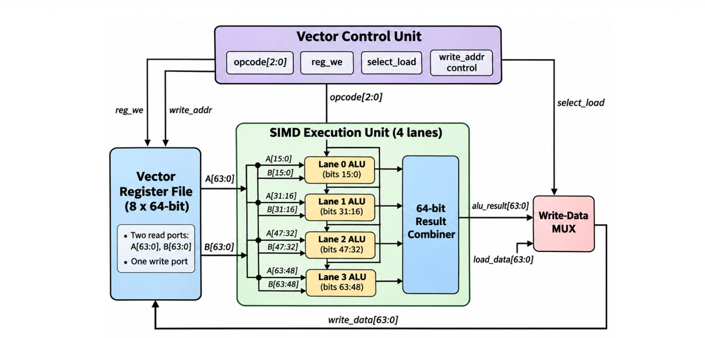
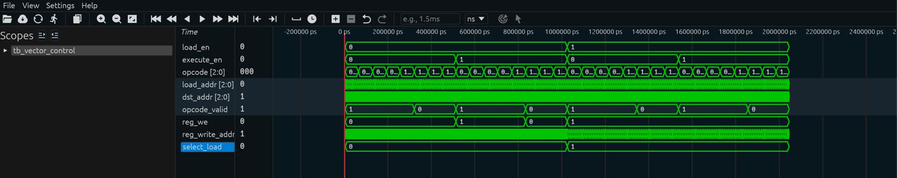
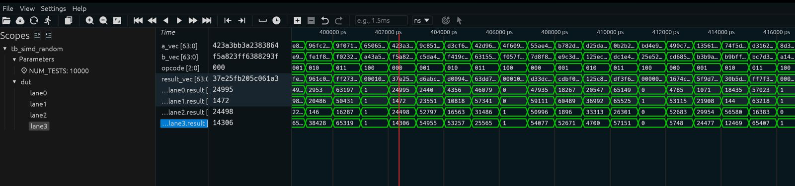
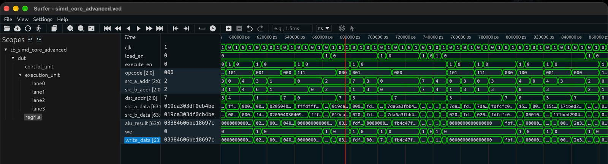
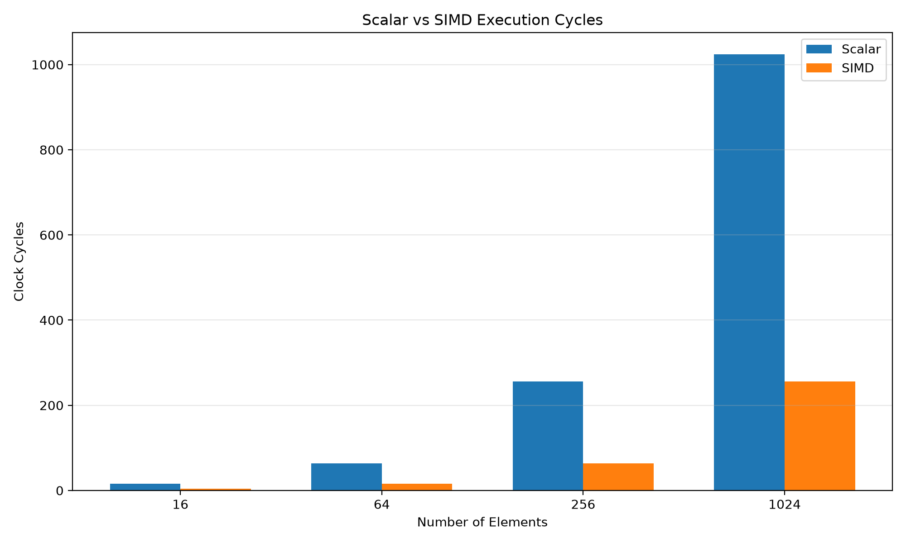
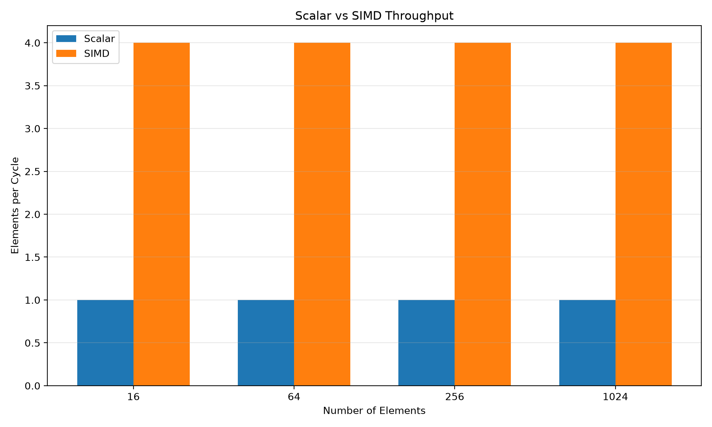

<div align="center">

# Four-Lane 16-Bit SIMD Vector Processing Unit

**Modern Computer Architecture · Project 11 · Intermediate+**  
**Newton School of Technology, Rishihood University**

**Verilog RTL · 4 Parallel ALUs · 64-Bit Vector Datapath · Verified Scalar Baseline · FPGA Evaluation**

[Architecture](#architecture) · [RTL Modules](#rtl-modules) · [Run the Project](#quick-start) · [Verification](#verification-results) · [Performance](#scalar-vs-simd-benchmark) · [FPGA Results](#fpga-synthesis-and-timing) · [Team](#team-and-contributions)

</div>

## Overview

This project designs, implements, and evaluates a **Single Instruction, Multiple Data (SIMD)** processor using synthesizable Verilog. Four independent **16-bit ALUs** execute the same instruction simultaneously on four different data elements. Two **64-bit vector operands** are read from an **8 × 64-bit register file**, processed in parallel, and optionally written back to a destination register.

For a controlled comparison, the project also implements a **single-lane, 16-bit scalar processor** with the same ALU operations and the same **512-bit total register capacity**. Functional simulation, randomized verification, cycle-count benchmarking, iCE40-targeted FPGA synthesis, and place-and-route timing analysis have been performed.

**Key verified findings:** the SIMD core performs four element operations per execution cycle instead of one, reducing the benchmark's simulated execution cycles by **75% (4× cycle speed-up)**. At a common **50 MHz** target both wrapper-equipped FPGA designs passed timing, supporting theoretical peak arithmetic rates of **50 million** versus **200 million 16-bit element operations per second**. These are architectural estimates and simulations—not measurements on a physical board.

## Architecture



### Hardware specifications

| Feature | SIMD implementation | Scalar reference |
|---|---|---|
| Parallel ALU lanes | **4** | **1** |
| Element width | 16 bits | 16 bits |
| Datapath width | 64 bits | 16 bits |
| Register file | 8 × 64-bit vectors | 32 × 16-bit scalars |
| Total register storage | **512 bits** | **512 bits** |
| Register access | Two asynchronous reads; one clocked write | Two asynchronous reads; one clocked write |
| Shared operation select | 3-bit opcode across all lanes | 3-bit opcode |
| Supported operations | ADD, SUB, AND, OR, unsigned less-than | Same |
| Write policy | External load has priority; invalid execute opcode does not write | Same |

The SIMD core is **not** a full instruction-fetching CPU or a standard vector ISA implementation. Control signals and register addresses are provided by its external interface.

### Per-lane datapath

| Lane | Operand A slice | Operand B slice | Result slice |
|---|---|---|---|
| Lane 0 | `[15:0]` | `[15:0]` | `[15:0]` |
| Lane 1 | `[31:16]` | `[31:16]` | `[31:16]` |
| Lane 2 | `[47:32]` | `[47:32]` | `[47:32]` |
| Lane 3 | `[63:48]` | `[63:48]` | `[63:48]` |

Each lane operates independently; addition/subtraction wrap modulo **2^16**, and carries do not cross lane boundaries.

### ALU opcode encoding

| Opcode | Operation | Per-lane behavior |
|---|---|---|
| `000` | ADD | `(A + B) mod 2^16` |
| `001` | SUB | `(A - B) mod 2^16` |
| `010` | AND | `A & B` |
| `011` | OR | `A \| B` |
| `100` | CMP | `1` when unsigned `A < B`, otherwise `0` |
| `101`–`111` | Invalid/reserved | No execute write-back; ALU default result is zero |

### Control and write-back

The vector control unit generates `reg_we`, `reg_write_addr`, `select_load`, and `opcode_valid` to coordinate the register file and ALUs.

```verilog
assign opcode_valid   = (opcode <= 3'b100);
assign reg_we         = load_en | (execute_en & opcode_valid);
assign reg_write_addr = load_en ? load_addr : dst_addr;
assign reg_write_data = load_en ? load_data : alu_result;
```

- `load_en = 1`: write external `load_data` to the addressed register at the next rising edge, even if `execute_en` is also asserted.
- `execute_en = 1` with a valid opcode and no load: write the SIMD result to the destination at the next rising edge.
- Both disabled, or invalid execution opcode without a load: preserve register contents.
- The register file has **no reset** in the verified core RTL; initialize source registers before reading them.

## RTL Modules

| File | Purpose |
|---|---|
| [`rtl/alu16.v`](rtl/alu16.v) | Combinational 16-bit ALU; shared functionality for SIMD and scalar |
| [`rtl/simd4.v`](rtl/simd4.v) | Four parallel ALU instances; 64-bit lane slicing and result packing |
| [`rtl/vector_regfile.v`](rtl/vector_regfile.v) | Eight 64-bit registers; two read ports, one write port |
| [`rtl/vector_control.v`](rtl/vector_control.v) | Opcode validation, write enables, address selection, load priority |
| [`rtl/simd_core.v`](rtl/simd_core.v) | Integrated register file, vector control, SIMD execution and write-back |
| [`rtl/scalar_regfile.v`](rtl/scalar_regfile.v) | 32 × 16-bit register file used by the reference processor |
| [`rtl/scalar_core.v`](rtl/scalar_core.v) | Single-ALU scalar reference with corresponding control behavior |

## Repository Layout

```text
mca-project/
├── rtl/
│   ├── alu16.v
│   ├── simd4.v
│   ├── vector_regfile.v
│   ├── vector_control.v
│   ├── simd_core.v
│   ├── scalar_regfile.v
│   ├── scalar_core.v
│   ├── fpga_timing_stimulus.v     # generated by timing script
│   ├── scalar_timing_top.v       # generated by timing script
│   └── simd_timing_top.v         # generated by timing script
├── tb/
│   ├── tb_alu16.v
│   ├── tb_simd4.v
│   ├── tb_vector_regfile.v
│   ├── tb_vector_control.v
│   ├── tb_simd_core.v
│   ├── tb_simd_random.v
│   ├── tb_simd_core_advanced.v
│   ├── tb_scalar_core.v
│   └── tb_scalar_vs_simd.v
├── scripts/
│   └── phase4_timing_v2.sh
├── results/
│   ├── benchmark_results.csv
│   ├── graphs/                   # generated benchmark graphs
│   └── synthesis/               # generated FPGA logs and netlists
├── docs/
│   ├── IEEE_Report/
│   │   └── IEEE_Project_Report.pdf
│   └── images/                   # architecture, waveforms, charts
├── Makefile
├── run_tests.sh
├── plot_benchmarks.py
└── README.md
```

Build products, timing reports, `.vcd` files, and `.vvp` executables are generated artifacts; their presence depends on which commands have been run. The `README` support package includes `docs/` assets and the timing script, but **does not replace your actual `rtl/` or `tb/` sources**.

## Quick Start

### Prerequisites

- **Icarus Verilog** (`iverilog`, `vvp`) for RTL simulation.
- **GNU Make** for the viva commands (`make`).
- **Python 3**, Matplotlib, and NumPy for plotting.
- **Yosys**, **nextpnr-ice40**, and **IceStorm** for optional FPGA implementation analysis.
- **Surfer** for viewing `.vcd` waveforms (optional).

On macOS with Homebrew:

```bash
brew install icarus-verilog yosys nextpnr-ice40 icestorm
python3 -m venv .venv
source .venv/bin/activate
python3 -m pip install matplotlib numpy
```

### Run all functional tests

```bash
git clone https://github.com/KapilKaranMathur/mca-project.git
cd mca-project
make doctor
make test
```

Or use the original regression runner:

```bash
bash run_tests.sh
```

### Viva commands

| Command | Action |
|---|---|
| `make help` | Show all available commands |
| `make test-alu` | Check 16-bit ALU operations |
| `make test-simd` | Verify four parallel lanes |
| `make test-regfile` | Verify vector register storage |
| `make test-control` | Exhaustively test vector-control combinations |
| `make test-core` | Verify basic integrated SIMD core |
| `make test-random` | Run randomized 4-lane tests |
| `make test-core-advanced` | Test control dependencies and write-back |
| `make test-scalar` | Test scalar reference implementation |
| `make benchmark` | Run matched scalar/SIMD workload and write the CSV |
| `make graphs` | Regenerate benchmark plots |
| `make synth` | Synthesize both original processors for iCE40 |
| `make timing` | Route both wrapper-equipped timing designs |
| `make summary` | Show LUT, carry, FF, RAM and timing results |
| `make waves` / `make wave` | List or open available VCD waveforms |
| `make viva` | Full suite: tests, benchmark, graphs, synthesis and timing |

**First-run timing setup:** execute `bash scripts/phase4_timing_v2.sh` once to generate `rtl/fpga_timing_stimulus.v`, `rtl/scalar_timing_top.v`, and `rtl/simd_timing_top.v` before `make timing` or `make viva`. The timing script runs synthesis and routing as well. The Makefile's FPGA targets require a local Yosys/nextpnr installation; for a short viva use `make test-core-advanced`, `make benchmark`, and `make wave` first.

## Verification Results

The team's latest shared simulation logs reported the following results. Rerun the final merged GitHub commit before submission.

| Testbench | Coverage and result |
|---|---|
| `tb_alu16.v` | **9** directed checks passed |
| `tb_simd4.v` | **5** SIMD vector checks passed |
| `tb_vector_regfile.v` | **5** register-file checks passed |
| `tb_vector_control.v` | **2,048** exhaustive control combinations passed |
| `tb_simd_core.v` | **13** integrated core checks passed |
| `tb_simd_random.v` | **10,012** vector tests; **40,048** lane checks passed |
| `tb_simd_core_advanced.v` | **279** transactions; **224** register-readback checks passed |
| `tb_scalar_core.v` | **59** checks passed |
| `tb_scalar_vs_simd.v` | **6,800** scalar/SIMD output pairs matched |

### Evidence: vector control and execution



*Figure 1. Vector control unit signals during exhaustive verification.*



*Figure 2. Randomized verification of the shared opcode and independent 16-bit lane outputs.*



*Figure 3. Integrated core execution, register access and write-back behavior.*

## Scalar vs SIMD Benchmark

The benchmark executes the **same element-wise computation** on both processors for all five operations with **16, 64, 256, and 1,024 elements** each. Every scalar result is compared against its corresponding SIMD result.

| Elements | Scalar execution cycles | SIMD execution cycles | Scalar load + execute cycles | SIMD load + execute cycles |
|---:|---:|---:|---:|---:|
| 16 | 16 | 4 | 48 | 12 |
| 64 | 64 | 16 | 192 | 48 |
| 256 | 256 | 64 | 768 | 192 |
| 1,024 | 1,024 | 256 | 3,072 | 768 |

The cycle counts are identical across ADD, SUB, AND, OR, and CMP for the selected workloads. This yields **4× fewer simulated execution cycles** (75% fewer cycles). The loading-inclusive result also reflects different external data widths: the scalar baseline loads 16 bits per cycle, while SIMD loads 64 bits per cycle.





To reproduce the CSV and graphics:

```bash
make benchmark
make graphs
# Alternative:
python3 plot_benchmarks.py results/benchmark_results.csv results/graphs
```

**Interpretation:** 4× is a *simulated-cycle* improvement for a workload with four independent elements per SIMD operation. It is **not proof of 4× wall-clock speed-up at unrelated maximum clock frequencies**.

## FPGA Synthesis and Timing

**Toolchain:** Yosys + nextpnr-ice40; **target architecture:** Lattice iCE40 HX8K, CT256 package. Synthesis and place-and-route are software-based estimates; no FPGA board was programmed.

### Original core-only synthesis (`synth_ice40`)

| FPGA resource | Scalar core | SIMD core |
|---|---:|---:|
| LUT4 cells | 1,032 | 1,229 |
| Enabled flip-flops (`SB_DFFE`) | 512 | 512 |
| Carry cells (`SB_CARRY`) | 31 | 124 |
| Block RAM | 0 | 0 |

**Observation:** the full SIMD core used approximately **19.1% more LUT4 cells** than the scalar core at this synthesis stage, while both provided 512 bits of register storage. The four ALU lanes use four times as many carry cells.

### Matched flop-backed timing-wrapper implementations (`-nobram`)

| FPGA resource / result | Scalar wrapper | SIMD wrapper |
|---|---:|---:|
| LUT4 cells | 1,015 | 1,259 |
| Carry cells | 31 | 124 |
| Total flip-flops, including wrappers | 614 | 662 |
| Block RAM | 0 | 0 |
| Final routed Fmax estimate | **57.05 MHz** | **71.31 MHz** |
| Timing at a 50 MHz target | **PASS** | **PASS** |

The SIMD timing-wrapper implementation used approximately **24.0% more LUT4 cells**. The different flip-flop counts include input-generation and output-observation registers, not just processor register storage.

**Critical qualification:** these Fmax estimates include the FPGA-facing stimulus and capture wrappers. The observed critical paths involved control/register-write logic; they should **not** be represented as isolated ALU Fmax values. Original cores have wide I/O interfaces, so wrappers were used for a valid device-level place-and-route experiment.

### Theoretical throughput at a common 50 MHz clock

| Metric | Scalar | SIMD |
|---|---:|---:|
| Element operations / execution cycle | 1 | 4 |
| Ideal peak element operations / second | 50 million | 200 million |
| Relative peak arithmetic throughput | 1× | 4× |

This comparison assumes operands are available and one scalar operation or four SIMD lane operations are issued each cycle. It does not incorporate software overhead, stalls, memory-system bandwidth or physical FPGA measurements.

Reproduce the wrapper-based FPGA experiment:

```bash
bash scripts/phase4_timing_v2.sh
# Or use the Makefile after the wrapper RTL files exist:
make timing
make summary
```

Generated reports are saved under `results/synthesis/timing_v2/` or the Makefile's `results/synthesis/viva_timing/` directory.

## Project Report

The [final IEEE-format project report](doc/IEEE_Report/IEEE_Project_Report.pdf) includes the literature review, architecture, verification waveforms, scalar/SIMD comparison, FPGA implementation results, conclusions, references and team contributions.


## Team and Contributions

| Team member | Student ID | Assigned workstream for GitHub handoff |
|---|---|---|
| Agrim Kumar Malhotra | 2401010045 | Vector control, integrated core and advanced verification |
| Aniket Pathak | 2401020088 | SIMD lanes, randomized verification, benchmark and graphs |
| Kapil Karan Mathur | 2401010209 | 16-bit ALU, scalar baseline and unit tests |
| Rohan Singh | 2401010391 | Vector register file, testbench and FPGA wrappers |
| Pushpendra Singh Parihar | 2401010361 | Regression runner, integrated verification, IEEE report and documentation |

These are the **agreed responsibility areas for repository handoff**, not independently verified claims of file authorship. Commit history and the final IEEE report's Individual Contributions section should reflect the work each member actually performed.

## Project Status and Limitations

**Completed based on the supplied project logs:** synthesizable RTL, independently tested vector/control modules, integrated verification, randomized self-checking, scalar reference, 6,800 matched benchmark outputs, benchmark plots, Yosys resource analysis and successful 50 MHz place-and-route timing experiments.

**Remaining before final submission:** rerun regressions from the final merged commit, confirm repository image/report links, review contributor attribution, and demonstrate the project using the submitted code.

**Not claimed:** on-board FPGA execution, physical power measurements, complete ISA/processor front end, or independently characterized processor-only maximum frequency.

---

<div align="center">

**Project 11 · Four-Lane 16-Bit SIMD Vector Processing Unit**  
*Verilog design • Verification • Quantitative benchmarking • FPGA synthesis and timing*

</div>
